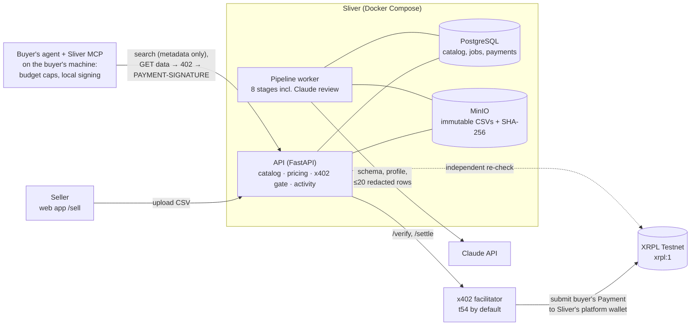
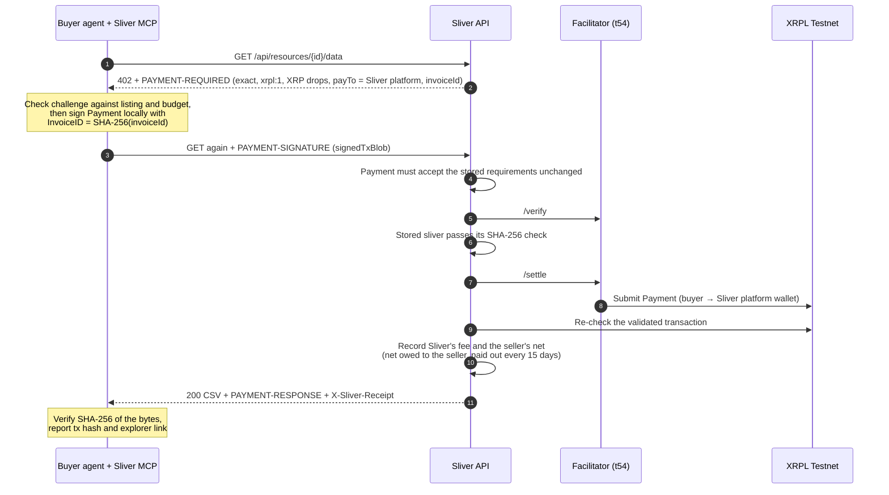

# Sliver

**A data marketplace for AI agents, settled with x402 on the XRP Ledger.** Sellers upload a CSV. Sliver inspects it, has Claude write the public listing, cuts it into small slices ("slivers") and suggests an explainable price for each before the seller publishes. Buying agents find a sliver, check that it fits, and pay Sliver on XRPL Testnet with one retried HTTP request. Sliver keeps a platform fee (10% by default) and pays the seller the rest every 15 days. Sliver never holds buyer keys and never spends on a buyer's behalf.

Ripple track. Built after the team's SingHacks finalist [Ledger402](https://github.com/LAIN-21/ripple-challenge), see [Since SingHacks](#since-singhacks).

| Looking for | Go to |
|---|---|
| Buy from your own agent | [Sliver MCP](packages/sliver-mcp/README.md): free and open source, runs on your machine |
| How payment works | [x402 on XRPL Testnet](#x402-on-xrpl-testnet-step-by-step) · [ADR 0004](docs/adr/0004-x402-payments-on-xrpl.md) |
| Where to check each judging criterion | [Criteria map](#criteria-map) |
| Demo video script | [docs/DEMO.md](docs/DEMO.md) |
| Builder feedback | [docs/BUILDER_FEEDBACK.md](docs/BUILDER_FEEDBACK.md) |

## The problem

**Buying agents** need small, specific facts, such as "container spot rates Singapore → Shanghai since September". Today they get a whole dataset behind a subscription, an API key and a human sign-up. An agent can't sign a contract, and it shouldn't pay for a whole dataset when it needs one lane's 34 rows.

**Data owners** have useful tables but no cheap way to sell them to machines. Pricing, packaging, privacy checks and payment collection each take work, publishing raw data risks leaking what they meant to sell, and they can't see what buyers are looking for.

**Sliver** turns an uploaded table into machine-purchasable slivers. Each one is a whole dataset or one slice of it (one lane, one route, one month), stored as its own immutable file with its own SHA-256. Agents discover slivers through metadata only and pay per sliver with x402. The bytes they receive are exactly the ones whose hash was listed.

## Architecture



Pipeline stages: validate → profile → privacy → duplicates → Claude review → research (opt-in) → package → decide. An accepted dataset then waits for its seller, who reviews the suggested prices, accepts or overrides them, and publishes. The web app (marketplace, seller pages and insights, live `/activity` timeline) talks to the same API.

The four responsibilities (seller, catalog, buyer interface, transactions) and every decision behind them are in [docs/ARCHITECTURE.md](docs/ARCHITECTURE.md). Product invariants are in [docs/PRODUCT.md](docs/PRODUCT.md). The stack (Python 3.13, FastAPI 0.115, SQLAlchemy 2, PostgreSQL, MinIO, React + Vite) is in [ADR 0003](docs/adr/0003-application-stack-and-local-containers.md).

## Quick start

Needs Git, Make and Docker with Compose v2. No Python or Node on the host. macOS, Linux, or Windows through WSL.

```bash
make doctor
```

```bash
make dev-start
```

The first run creates `.env` from `.env.example` and builds the images (several minutes, since MinIO is built from source). Open http://127.0.0.1:5173. The footer shows API, database and storage health, and the API docs are at http://127.0.0.1:8000/docs.

To sign in as a seller and buy on Testnet:

1. In `.env`, choose local values for `SLIVER_SELLER_PASSWORD` and `SLIVER_REVIEWER_PASSWORD`. Optionally set `ANTHROPIC_API_KEY`; without it the pipeline uses a deterministic offline fallback. Then run `make dev-start` again so the containers pick them up.
2. Load the demo catalog (4 synthetic logistics datasets from 2 demo sellers, 21 slivers):

   ```bash
   make seed
   ```

3. Create faucet-funded Testnet wallets for Sliver's platform (which receives every payment), the demo sellers and a demo buyer. The seeds go only into your gitignored `.env`. The command also writes `SLIVER_PLATFORM_ADDRESS` and recreates the running API and worker so they pick it up.

   ```bash
   make wallets
   ```

4. Make a real Testnet purchase with t54's official x402 client:

   ```bash
   make smoke-testnet
   ```

   This buys the cheapest sliver, checks the bytes against the catalog SHA-256, replays the payment to show it isn't charged twice, asks the x402.org facilitator to verify the requirements, and prints the transaction with its explorer link.

5. Run the whole story with one command:

   ```bash
   make demo
   ```

   A demo seller uploads a fresh synthetic table, the pipeline accepts it (or, if it misses the quality threshold with no blocking finding, the demo reviewer approves it), and the seller publishes it at the suggested prices. A scripted buyer running the Sliver MCP's own code then declines a question Sliver can't answer and buys last month's sliver on Testnet within a $5 budget. The validated transaction is written into [Testnet transactions](#testnet-transactions-from-make-demo). It runs `make wallets` itself and never resets data ([details](docs/DEVELOPMENT.md#demo-make-demo)).

Sign in at http://127.0.0.1:5173/sell/login as `harbour-analytics@sliver.local`, `strait-line-data@sliver.local` or `reviewer@sliver.local`. As a seller, upload a CSV at `/sell/upload`; once it is accepted, its page shows "Price and publish". Your earnings and unmet buyer demand are at `/sell/insights`. `make dev-stop` stops the stack and keeps its data. Every target is described in [docs/DEVELOPMENT.md](docs/DEVELOPMENT.md#make-targets).

## Buy with your agent (Sliver MCP)

The [Sliver MCP](packages/sliver-mcp/README.md) is the buyer's own tool. It runs over stdio on the buyer's machine, signs payments locally with the buyer's Testnet wallet, and pays Sliver's platform wallet. The seed never leaves the machine. Requires [uv](https://docs.astral.sh/uv/).

```bash
uvx --from "git+https://github.com/LAIN-21/sliver#subdirectory=packages/sliver-mcp" sliver-mcp wallet init
```

```bash
claude mcp add sliver -- uvx --from "git+https://github.com/LAIN-21/sliver#subdirectory=packages/sliver-mcp" sliver-mcp
```

The first command creates and faucet-funds a Testnet wallet in `~/.sliver/wallet.json` (mode 0600). The second adds the server to Claude Code. The Claude Desktop and Cursor JSON, and every setting (`SLIVER_API_URL`, the caps, the RPC allow-list), are in the [MCP README](packages/sliver-mcp/README.md#install).

| Tool | What it does | Spends? |
|---|---|---|
| `sliver_search` | Search the catalog (public metadata only) | No |
| `sliver_inspect` | Full listing: columns, coverage, provenance, price, SHA-256 | No |
| `sliver_evaluate` | Deterministic fit report: `buy`, `skip` or `look_elsewhere`, with reasons, and a custom-slice suggestion when the best sliver covers much more than the need | No |
| `sliver_quote_slice` | Quote a custom slice: just the rows the need covers, priced per row, as an unlisted sliver to buy | No |
| `sliver_buy` | Buy one sliver within a budget, verify its SHA-256, return tx hash and explorer link | Yes (Testnet XRP) |
| `sliver_wallet` | Address, balance, last-24-hour spend (never the seed) | No |
| `sliver_purchases` | Purchases made from this machine | No |

Then ask your agent something like "Find weekly container spot rates from Singapore to Shanghai since September. Budget $5."

Any x402 v2 XRPL client can buy too. `make smoke-testnet` uses t54's SDK, and `GET /.well-known/x402` lists every paid endpoint and price.

## x402 on XRPL Testnet, step by step



1. **Challenge.** `GET /api/resources/{id}/data` without payment answers HTTP 402. The x402 v2 `PAYMENT-REQUIRED` header (also sent as the JSON body) offers the `exact` scheme on network `xrpl:1` (Testnet), asset XRP in drops. `payTo` is **Sliver's platform address** (`SLIVER_PLATFORM_ADDRESS`, [ADR 0005](docs/adr/0005-platform-collection-and-payouts.md)), and the challenge carries a fresh `extra.invoiceId`, `extra.sourceTag` and `extra.areFeesSponsored: false`, so the same challenge satisfies both t54 and the official spec.
2. **Buyer checks before signing.** The MCP refuses unless the network is `xrpl:1`, the amount equals the listing's USD price at the disclosed rate (`DROPS_PER_USD`, default 400,000 drops per USD), the payee matches the platform address it pinned for this Sliver API, and the price fits the human's budget and the local caps.
3. **Sign locally.** The buyer's wallet signs an XRPL Payment with `InvoiceID = SHA-256(invoiceId)`, the challenge's `SourceTag`, a bounded `LastLedgerSequence` and a capped fee. It has no Memos, SendMax, DeliverMin, Paths or partial-payment flag ([`sliver_x402/payment.py`](packages/sliver-x402/src/sliver_x402/payment.py)).
4. **Retry with `PAYMENT-SIGNATURE`.** Sliver matches it to the stored invoice. A payment that changes any requirement, such as a lower amount, is rejected first.
5. **Verify, then check the bytes.** The facilitator's `/verify` runs, then Sliver checks the stored sliver against its SHA-256. Money doesn't move for a sliver whose stored bytes are missing or altered. Sliver reads the bytes again to deliver them; if that read fails after settlement, retrying the same payment re-delivers without settling again.
6. **Settle.** The facilitator's `/settle` submits the presigned Payment. It goes from the buyer's account to Sliver's platform wallet. Sliver never signs it; the buyer did.
7. **Independent ledger re-check.** Sliver doesn't take the facilitator's word. The transaction must be validated, `tesSUCCESS`, a Payment to `payTo` with `delivered_amount` exactly equal to the invoice, no partial-payment flag, and the right `InvoiceID` ([`payments/ledger_check.py`](apps/api/sliver_api/payments/ledger_check.py)).
8. **Deliver.** 200 with the CSV, `PAYMENT-RESPONSE` (with the tx hash) and `X-Sliver-Receipt`. `GET /api/receipts/{id}` is the public receipt with the explorer link. Replaying the same payment re-delivers without settling twice, and a second transaction for a paid invoice gets 409.
9. **Record the split.** In the same commit that marks the sale delivered, Sliver records its platform fee (`SLIVER_PLATFORM_FEE_BPS`, default 10%) and the seller's net, in drops and USD cents, with the fee rounded down in the seller's favour. The net is added to the seller's balance, which Sliver pays out on the 1st and 16th of each month (UTC). The receipt and `/purchases/{id}` show the split ([ADR 0005](docs/adr/0005-platform-collection-and-payouts.md)).

Every step is recorded as a public activity event (no headers, blobs, invoice ids or keys), shown live at `/activity` and `/purchases/{id}` and streamed from `GET /api/activity/stream`. The full design is in [ADR 0004](docs/adr/0004-x402-payments-on-xrpl.md), [ADR 0005](docs/adr/0005-platform-collection-and-payouts.md) and [docs/agents/transactions.md](docs/agents/transactions.md).

### Testnet transactions from `make demo`

Runs before [ADR 0005](docs/adr/0005-platform-collection-and-payouts.md) paid the seller directly; later runs pay Sliver's platform wallet.

<!-- demo-tx:start -->
_Written by `make demo` on 2026-11-09 12:26 UTC (run `20261109T122601Z`). Each transaction was read back from XRPL Testnet (`s.altnet.rippletest.net`): a validated `tesSUCCESS` Payment from the buyer's wallet straight to the seller. Re-run `make demo` to replace this block; do not edit it by hand._

| Transaction | Ledger | Amount | Buyer → seller | Sliver |
|---|---|---|---|---|
| [`EBB62A05AEF0761C9A092EE5B13ACE8FB8BE00004C9F9C262CD81E78A5D1645B`](https://testnet.xrpl.org/transactions/EBB62A05AEF0761C9A092EE5B13ACE8FB8BE00004C9F9C262CD81E78A5D1645B) | 22190609 | 0.472 XRP ($1.18) | [`rHnhNeqqWDqm9vx9yDiTW9cHK9Ps1s7w1w`](https://testnet.xrpl.org/accounts/rHnhNeqqWDqm9vx9yDiTW9cHK9Ps1s7w1w) → [`rEbme52s62cjVSqbxiUqd94kRsMwoxm7Nd`](https://testnet.xrpl.org/accounts/rEbme52s62cjVSqbxiUqd94kRsMwoxm7Nd) | Singapore Daily Anchorage Wait Times by Vessel Type and Anchorage Queue Size: October 2026 |

In this run the demo seller uploaded “Singapore anchorage waiting times, daily (demo run 20261109T122601Z)” (184 rows). It was accepted automatically (quality 81) after the pipeline's checks (AI review: Claude (claude-opus-5-5)), and the seller published 7 slivers at their suggested prices. The buyer then asked two questions with a $5 budget, using the Sliver MCP's own search, evaluator and budget-capped buyer:

1. “Air-cargo rates from Singapore Changi (SIN) to Frankfurt (FRA), per kg. Budget $5.” → `look_elsewhere`: nothing was signed or spent.
2. “Daily anchorage wait hours in Singapore for container ships, tankers and bulk carriers in October 2026. Budget $5.” → `buy` “Singapore Daily Anchorage Wait Times by Vessel Type and Anchorage Queue Size: October 2026” for $1.18: paid, delivered and SHA-256-verified.
<!-- demo-tx:end -->

## XRPL AI Starter Kit integration

t54 contributed XRPL x402 support to the XRPL AI Starter Kit: the `x402-xrpl` Python SDK and a hosted Testnet facilitator. Sliver uses both.

| Starter Kit piece | Where Sliver uses it |
|---|---|
| `x402-xrpl==0.3.4` types (`PaymentRequired`, `PaymentRequirements`, `PaymentPayload`) | Builds every 402 challenge and parses `PAYMENT-SIGNATURE`: [`payments/x402.py`](apps/api/sliver_api/payments/x402.py) |
| `x402-xrpl` `FacilitatorClient` | `/verify` and `/settle`: [`payments/adapters.py`](apps/api/sliver_api/payments/adapters.py) |
| t54 hosted Testnet facilitator | Default `FACILITATOR_URL`. `https://x402.org/facilitator` can be set instead; its `/verify` accepts our payments, but no settlement has been run through it |
| `x402-xrpl` buyer client (`XRPLPresignedPaymentPayer`, `x402_requests`) | Real end-to-end purchase in `make smoke-testnet`: [`payments/smoke.py`](apps/api/sliver_api/payments/smoke.py) |
| The SDK's FastAPI merchant path | Why the API is FastAPI ([ADR 0003](docs/adr/0003-application-stack-and-local-containers.md)). Challenges are built per listing rather than with the static middleware, because each sliver has its own price and seller. |
| `xrpl-py` | Wallets (`make wallets`), local signing in the MCP, ledger reads for the re-check |

The buyer MCP signs with [`sliver-x402`](packages/sliver-x402/README.md), a small client of our own, because the SDK's `uvicorn<0.31` pin conflicts with the `mcp` SDK. Its payments settle through the same t54 facilitator, and the official x402.org facilitator verifies them. What that taught us is in [docs/BUILDER_FEEDBACK.md](docs/BUILDER_FEEDBACK.md).

## Business model

Sellers list data for sale. On every sale the seller gets paid and Sliver takes a cut, the platform fee (10% by default).

- **The buyer pays Sliver.** The full listed price goes to Sliver's platform wallet in one standard x402 Payment.
- **Sliver pays the seller every 15 days.** Each delivered sale records the fee rate in force, Sliver's fee and the seller's net, so a later rate change never rewrites a past sale. The nets are the seller's balance, paid out on the 1st and 16th of each month (UTC). Payouts are not automated yet. Sales paid straight to a seller before this model carry no fee and are not owed.
- **Sellers see it before and after.** The pricing panel shows "you receive $X after Sliver's 10%" at each price. `/sell/insights` shows the balance Sliver owes, the next payout date, and gross, fee and net per sale with transaction links.
- **Custody, on Testnet only.** Sliver holds collected funds until the payout. An atomic XRPL Batch payment (`BatchV1_1` is enabled on Testnet and Mainnet) could pay the seller and Sliver in one transaction and remove custody, but standard x402 clients and facilitators sign and settle a single Payment. See [ADR 0005](docs/adr/0005-platform-collection-and-payouts.md).

## Pricing, publishing and seller insights

- **Deterministic, explainable price.** For each sliver, [`valuation.py`](apps/api/sliver_api/valuation.py) computes *suggested = base × quality × uniqueness × demand × public availability × coverage*. The base is the median price of at least two published comparables in the same category, otherwise a fixed category base. Quality comes from the acceptance score. Overlap with catalog data that the duplicates stage measured lowers uniqueness. Matching unmet searches from the last 30 days raise demand (up to +50%). A free equivalent found by research lowers public availability. Row count sets coverage. Every factor comes back with its inputs and reason, the breakdown multiplies out exactly to the price, and a range is shown around it. The same inputs always give the same price.
- **Claude explains, never prices.** Claude gets only the computed numbers and the factor reasons (no rows, provenance or search texts) and writes the explanation ([`seller/pricing.py`](apps/api/sliver_api/seller/pricing.py), versioned prompt `valuation_explanation.v1`). If its text contains a number that isn't in its input, the call fails, or there is no API key, a template is used instead. Publishing never calls Claude.
- **The seller decides.** On the dataset page, "Price and publish" shows each sliver's suggestion, range and a "Why?" breakdown. The seller accepts or overrides each price and publishes all slivers together (`GET /api/seller/datasets/{id}/valuation`, `POST /api/seller/datasets/{id}/publish`). Each published sliver keeps a private snapshot of its valuation.
- **Opt-in sample rows.** Nothing from the table is public by default. The seller may make up to five rows public, and a row with any privacy-flagged value is refused. A sliver shows only the selected rows that belong to it.
- **Custom slices.** A buyer's agent can ask for exactly the rows it needs from a full-dataset listing: a date range and/or one value of a category column (`GET /api/resources/{id}/slices`, the MCP's `sliver_quote_slice`). Sliver cuts them from the stored, hash-checked dataset into an unlisted sliver with its own SHA-256, priced *min(full price, max($0.10, full price ÷ rows × slice rows))*, so it never costs more than the full dataset and fewer rows never cost more. The seller's published price is the reference. It is bought through the same x402 path like any sliver: the buyer pays through Sliver, and the seller is credited (net of Sliver's fee) and paid out on the 15-day schedule. It shows in the seller's earnings with a "custom slice" tag. Identical requests return the same sliver; slices under five rows, or identical to an existing sliver, are refused. Sellers can turn custom slices off when they publish.
- **Insights.** `/sell/insights` (`GET /api/seller/insights`) shows the seller's balance: what Sliver owes them, the next payout date and the payout history. It also shows their earnings, with each delivered purchase's gross, Sliver's fee and the seller's net linked to its Testnet transaction, updating live from the activity stream.

## AI in the loop

- **Seller side: Claude reviews every upload.** The `ai_review` stage asks Claude (structured output through a strict tool call, versioned prompts in [`apps/api/sliver_api/prompts/`](apps/api/sliver_api/prompts)) for the category, tags, public title and description, quality and sensitivity concerns, and how to slice the table. Optional research (`SLIVER_AI_RESEARCH=true`) uses Claude's web search to check whether the same data is already freely available. Model output is validated and only shapes metadata and slicing. It can send a dataset to a human reviewer but never accept one.
- **Pricing: Claude explains the numbers.** The price itself is a deterministic formula; Claude only writes the seller-facing explanation, guarded against invented numbers ([above](#pricing-publishing-and-seller-insights)).
- **Buyer side: the buyer's own agent decides.** The Sliver MCP gives any agent a deterministic `sliver_evaluate` fit report and tells it to say "look elsewhere" rather than buy a near miss. Sliver hosts no buying agent.

## Security and safeguards

- **No buyer keys; custody only of Testnet sales.** Buyers sign their own payments to Sliver's platform wallet. Sliver never signs for a buyer and never stores or reads buyer keys. The platform seed lives only in the gitignored `.env`, and the API never reads it ([transactions.md](docs/agents/transactions.md), [ADR 0005](docs/adr/0005-platform-collection-and-payouts.md)).
- **No autonomous spending by Sliver.** A product invariant ([PRODUCT.md](docs/PRODUCT.md)): spending decisions belong to the buyer's agent and its human.
- **Buyer budget caps in the MCP.** `sliver_buy` refuses before signing when there is no `budget_usd`, the price exceeds it, it would break the per-purchase cap (default $5) or the rolling 24-hour cap (default $20), another purchase is in flight, or the 402 challenge differs from the listing (amount, network, pinned payee). The spend ledger is written before a payment leaves the machine.
- **Metadata-only discovery.** Every catalog discovery response goes through one allow-list serializer ([`catalog/public.py`](apps/api/sliver_api/catalog/public.py)), covered by a leak test. Only `published` slivers are visible. Object keys, owner emails and rights statements never leave the API, and neither do rows, except up to five sample rows the seller explicitly made public.
- **Privacy stage.** Uploads are scanned for emails, phone numbers, Luhn-valid card numbers, IBANs and NRIC/FIN. Findings name columns and row numbers, never values. Claude sees at most 20 sample rows, with flagged cells replaced by `[redacted]`. A leak guard rejects public text that contains raw cell values (other than dates and non-personal category values, see its limits under [Limitations](#limitations)).
- **Integrity.** Uploads and slivers are immutable objects with a SHA-256. The worker re-checks the hash before every stage, the API before every settlement, and the MCP after every delivery.
- **Testnet only.** Network `xrpl:1` and an HTTPS allow-list of Testnet RPC endpoints are enforced in configuration, and mainnet is refused.
- **Web sessions.** Demo accounts only, with scrypt password hashes, `HttpOnly` / `SameSite=Lax` cookies, an `Origin` allow-list on every mutation, and upload size limits enforced before parsing.

## Tests and CI

| Suite | Covers | Run |
|---|---|---|
| API (`apps/api/tests`) | Payments with a stub facilitator and stub ledger (402 shape, replay, rival transactions, the ledger re-check matrix, tampered requirements, mainnet refusal), catalog leak test, pipeline stages, AI review with a stubbed SDK, valuation (determinism, each factor's direction, publish, sample-row refusals, the explanation's number guard, insights), custom slices (filter validation, dedupe, pricing properties, unlisted, toggle, rate limit, x402 purchase with the fee snapshot), platform fee (rounding, snapshot surviving a rate change, insights totals, setting bounds, public receipt), auth, activity feed | `make test` |
| Buyer packages (`packages/`) and `make demo` (`scripts/tests`) | Every `sliver_buy` refusal (asserting nothing was signed), signed-transaction fields, fit evaluation and custom-slice suggestions, quotes that never spend, MCP protocol end to end; the demo's README block writer, Testnet guards, ledger checks, demo table and buyer questions | `cd packages && uv sync --all-packages && uv run pytest` |
| Lint | Ruff for Python, TypeScript typecheck for the web app | `make lint` |

[CI](.github/workflows/ci.yml) runs on every pull request: shellcheck, actionlint and Compose validation; API lint and tests against PostgreSQL; web typecheck and build; the buyer packages on Python 3.11 and 3.13; and the full containerized stack (`make install` twice without overwriting `.env`, all five services healthy, `make test` and `make lint` in containers, `make seed` twice, degraded health with storage stopped, volumes kept on stop). Tests never call the Claude API, a facilitator or the ledger. The real Testnet purchases are `make smoke-testnet` and `make demo`.

## Criteria map

| Criterion | Where to look |
|---|---|
| Reachability | One-line MCP install for Claude Code, Claude Desktop and Cursor ([MCP README](packages/sliver-mcp/README.md)); any x402 v2 client works, and paid endpoints are listed at `GET /.well-known/x402`; the whole stack runs with `make dev-start` |
| Creativity: AI-native | Claude writes listings and slicing from redacted samples ([`pipeline/ai_review.py`](apps/api/sliver_api/pipeline/ai_review.py)); Claude explains each deterministic price, guarded against invented numbers ([`seller/pricing.py`](apps/api/sliver_api/seller/pricing.py)); unmet agent searches raise prices and show sellers what to supply ([pricing and insights](#pricing-publishing-and-seller-insights)); agents evaluate fit before buying ([`sliver_mcp/evaluate.py`](packages/sliver-mcp/src/sliver_mcp/evaluate.py)) |
| Creativity: XRPL AI Starter Kit + x402 | [Starter Kit integration](#xrpl-ai-starter-kit-integration); [ADR 0004](docs/adr/0004-x402-payments-on-xrpl.md) |
| Feasibility | One standard x402 payment per sale to Sliver, with the fee and the seller's net recorded and paid out every 15 days; the full seller loop from upload to explainable price, publication and live earnings; deterministic fallbacks without an API key; plain PostgreSQL job queue with no extra infrastructure ([ARCHITECTURE.md](docs/ARCHITECTURE.md)); [limitations](#limitations) stated openly |
| Technical depth: XRPL and x402 | Ledger re-check ([`ledger_check.py`](apps/api/sliver_api/payments/ledger_check.py)), purchase flow ([`payments/service.py`](apps/api/sliver_api/payments/service.py)), our own x402 client ([`sliver-x402`](packages/sliver-x402/README.md)) |
| Technical depth: agents | [`packages/sliver-mcp`](packages/sliver-mcp/README.md): seven tools, server instructions for honest buying, the spending policy in [`buyer.py`](packages/sliver-mcp/src/sliver_mcp/buyer.py) |
| Technical depth: security, tests, safeguards | [Security and safeguards](#security-and-safeguards), deterministic pricing with a full breakdown ([`valuation.py`](apps/api/sliver_api/valuation.py)), [Tests and CI](#tests-and-ci), [transactions.md](docs/agents/transactions.md), [seller.md](docs/agents/seller.md), [catalog.md](docs/agents/catalog.md) |
| UX: agent actions, payments, on-chain | Live `/activity` feed and `/purchases/{id}` timeline (402 → signature → verified → integrity → settlement → ledger validated → delivered, with explorer links); seller dataset page with each pipeline stage, Claude's listing and the "Price and publish" breakdown; `/sell/insights` with live earnings and tx links; [demo script](docs/DEMO.md) |
| Builder feedback | [docs/BUILDER_FEEDBACK.md](docs/BUILDER_FEEDBACK.md) |
| Transaction hashes | [Testnet transactions](#testnet-transactions-from-make-demo) (filled in by `make demo`) |

## Since SingHacks

At SingHacks 2026 the team built [Ledger402](https://github.com/LAIN-21/ripple-challenge), a finalist in the Ripple/XRPL challenge. It was the **buying agent**: given a business objective, it found data providers, ranked them, paid over x402 on XRPL Testnet, and kept spending decisions deterministic. Its providers and data were synthetic.

Sliver is **the marketplace on the other side**: the place a buying agent like Ledger402 buys from. Since SingHacks:

- A real seller side: uploads, an inspection pipeline, Claude review, slicing into slivers, a human reviewer queue, explainable pricing, publication and a live earnings and demand page.
- Payments moved to the official x402 v2 XRPL `exact` scheme: `InvoiceID` binding without memos (Ledger402 bound invoices with memos), and an independent ledger re-check.
- The buying agent became an open-source MCP that any agent can use, with the human's budget enforced locally. Ledger402 is now a reference buyer, not part of Sliver's architecture ([ARCHITECTURE.md](docs/ARCHITECTURE.md)).
- A live, public timeline of every payment step, with on-chain links.

## Limitations

- **Testnet only.** Testnet XRP has no value. The USD-to-XRP rate is a fixed, disclosed demo rate, not a market price. There is no RLUSD pricing, payout or refund flow. A settlement that fails the ledger re-check is marked failed and refunded by hand.
- **Sliver holds sales until payout, and payouts are manual.** Buyers pay Sliver's platform wallet. Sliver owes sellers their net until the next payout (1st and 16th, UTC), but nothing executes payouts yet and nothing marks sales as paid out. Holding other people's money needs custody, KYC/AML and money-transmission work before any Mainnet use.
- **Pricing is a demo calibration.** The category bases and factor weights in the valuation formula are not market research. Demand matching is term-based. Prices can't be changed after publishing. Custom slices are priced linearly per row, so one can cost less than a seller's pre-cut sliver of nearly the same rows.
- **No hosted deployment.** Everything runs locally in Docker with development images.
- **The facilitator is best effort with no SLA.** The real Testnet purchase is not part of CI. The x402.org facilitator can be configured with one setting, but only its `/verify` has been tested with our payments.
- **Payee pinning.** The public catalog does not publish Sliver's platform address yet, so the MCP trusts the payee on the first purchase from a Sliver API and pins it after that.
- **Heuristic checks.** The privacy scan is regex-based and can miss unknown formats. The leak guard matches whole values, ignores values shorter than four characters or longer than twelve words, and can miss reformatted numbers. Claude's concerns vary between runs, so borderline datasets can land on either side of the auto-accept threshold on their first review.
- **Demo accounts only.** There is no public sign-up. The public activity feed has no rate limit or moderation for agent notes.
- **The demo data is synthetic.**

## More

[Product](docs/PRODUCT.md) · [Architecture](docs/ARCHITECTURE.md) · [Development](docs/DEVELOPMENT.md) · [ADRs](docs/adr/README.md) · [Roadmap](docs/ROADMAP.md) · [Contributing](CONTRIBUTING.md) · [Coding agents](AGENTS.md)

Licensed under the [Apache License 2.0](LICENSE).
